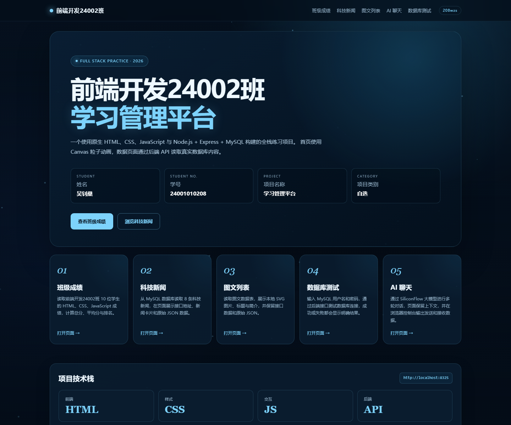
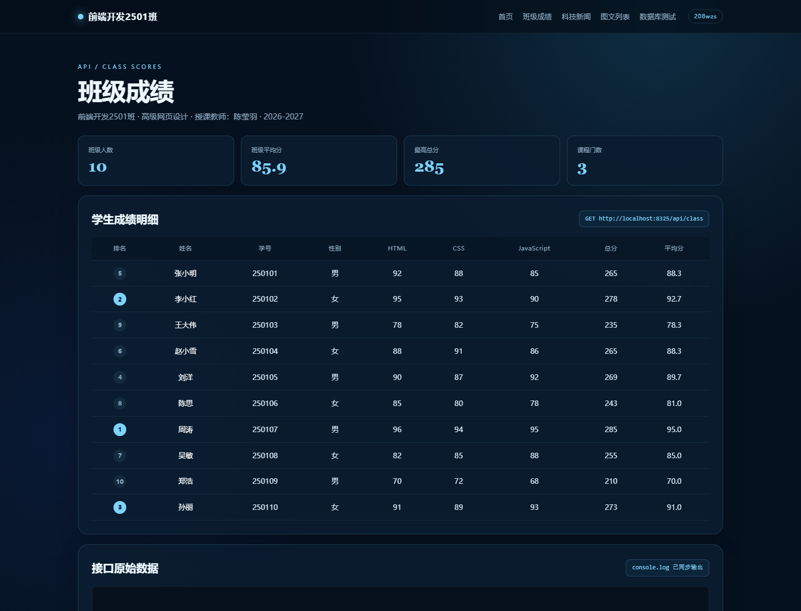
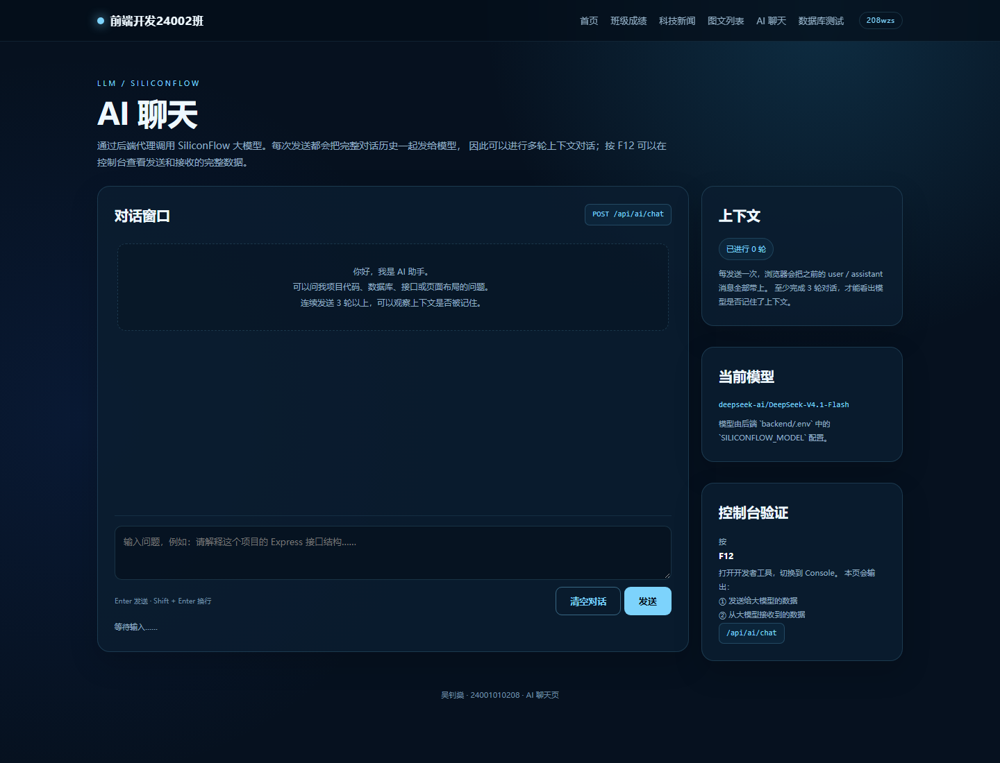

# 前端开发24002班学习管理平台

- 姓名：吴钊燊
- 学号：24001010208
- 班级：前端开发24002班
- 项目名称：前端开发24002班学习管理平台
- 项目类别：自选
- 技术栈：原生 HTML / CSS / JavaScript + Node.js / Express + MySQL
- 使用模型：DeepSeek / SiliconFlow DeepSeek-V4.1-Flash
- 完成时间：2026-11-23

## 项目简介

本项目是一个面向班级学习管理的全栈练习项目，数据源来自 `backend/Cheney_class.json`。页面包括：

- 首页：姓名学号、项目信息、Canvas 粒子动画、全部页面入口。
- 班级成绩：读取班级信息和 10 位学生成绩，计算总分、平均分和排名。
- 科技新闻：从 MySQL 读取 8 条科技新闻，页面展示接口地址和原始 JSON。
- 图文列表：从 MySQL 读取 8 条图文数据，图片使用本地 SVG。
- AI 聊天：通过后端代理调用 SiliconFlow，支持至少 3 轮上下文对话，并在浏览器控制台输出发送/接收数据。
- 数据库测试：输入 MySQL 用户名和密码，测试连接结果。

## 启动方式

1. 确保 MySQL 服务已启动。
2. 在项目根目录双击 `start.bat`。
3. 浏览器访问 `http://localhost:8325`。

也可以手动启动（本机 Node 不在 PATH 时使用完整路径）：

```powershell
cd D:\wx\fullstack_project
& "C:\Program Files\Huawei\DevEco Studio\tools\node\node.exe" backend\server.js
```

> 不要直接双击 `frontend` 目录下的 HTML 文件。直接打开时地址是 `file:///...`，页面里的 `fetch('/api/...')` 会变成请求本地文件，从而出现 `Failed to fetch`。
>
> 必须通过 Express 服务访问：
>
> - 首页：`http://localhost:8325/`
> - 新闻：`http://localhost:8325/news.html`
> - 成绩：`http://localhost:8325/scores.html`
> - 图文：`http://localhost:8325/gallery.html`
> - AI 聊天：`http://localhost:8325/ai.html`
> - 数据库测试：`http://localhost:8325/database.html`

## 数据库初始化

数据库连接配置在 `backend/.env`，已被 `.gitignore` 排除。

AI 聊天还需要在 `backend/.env` 填写 SiliconFlow 配置：

```text
SILICONFLOW_API_KEY=sk-你的密钥
SILICONFLOW_MODEL=deepseek-ai/DeepSeek-V4.1-Flash
SILICONFLOW_API_URL=https://api.siliconflow.cn/v1/chat/completions
```

修改 `.env` 后需要重启 `node backend/server.js`。API Key 只在后端使用，不会发送到浏览器。

> 本机开发环境 MySQL 的 root 密码为 `root`；如果在新机器上按指导书使用 root / 123456，请同步修改 `backend/.env` 的 `DB_PASSWORD`，数据库测试页默认密码也要相应调整。

完整建库、建表和测试数据 SQL 见：

```text
backend/Cheney_database.md
```

接口记录见：

```text
backend/Cheney_interface.md
```

AI 指令记录见：

```text
Cheney_prompt.md
```

## 目录结构

```text
fullstack_project/
├─ AGENTS.md
├─ Cheney_prompt.md
├─ README.md
├─ start.bat
├─ backend/
│  ├─ .env
│  ├─ server.js
│  ├─ config/
│  ├─ controllers/
│  ├─ models/
│  ├─ routes/
│  ├─ Cheney_interface.md
│  └─ Cheney_database.md
└─ frontend/
   ├─ index.html
   ├─ scores.html
   ├─ news.html
   ├─ gallery.html
   ├─ ai.html
   ├─ database.html
   ├─ css/
   ├─ js/
   └─ images/
```

## 接口一览

| 方法 | 地址 | 说明 |
| --- | --- | --- |
| GET | `/api/health` | 服务健康检查 |
| GET | `/api/class` | 班级信息与学生成绩 |
| GET | `/api/news` | 科技新闻列表 |
| GET | `/api/gallery` | 图文列表 |
| POST | `/api/ai/chat` | SiliconFlow 多轮 AI 聊天 |
| POST | `/api/database/test` | 测试 MySQL 连接 |

统一响应：

```json
{ "code": 0, "msg": "success", "data": {} }
```

## 运行截图






